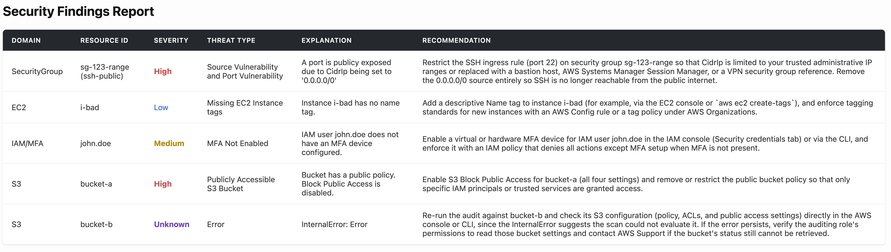
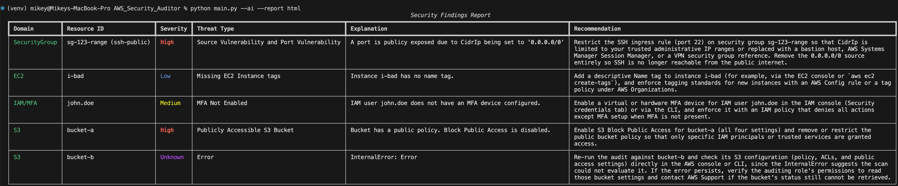

# AWS Security Auditor

Scans AWS account for security misconfigurations. Checks for publicly accessible S3 buckets, EC2 instances missing tags, IAM users without MFA, and overly permissive security groups. Generates a detailed CSV or HTML report with findings and optional AI-enhanced recommendations.

## Overview

**AWS Security Auditor** is a Python-based command-line utility built using the `boto3` library. The auditor performs deterministic checks across EC2 Security Groups, EC2 tags, IAM/MFA, and S3 public-access posture.

The auditor's findings use a shared schema of results that can be enriched by optional Claude recommendations.

AI does not decide whether a finding exists as all schema results are purely deterministic. AI is a separate and completely optional feature of the security auditor.

All security findings that are found by the auditor are printed out to the CLI as well as optionally to a CSV file, HTML file, or both - whichever the user chooses all via optional CLI arguments.

<p align="center">
  <strong> HTML output of the AWS Security Auditor </strong>
</p>

<p align="center">
  
</p>

<p align="center">
  <strong> Rich CLI output of the AWS Security Auditor </strong>
</p>

<p align="center">
  
</p>


## Features

* **Security Group exposure detection**

  * Determines if a security group is exposed via using a public source i.e. 0.0.0.0/0
  * Evaluates FromPort and ToPort ranges to determine if they are using sensitive ports i.e. 22, 3306, 5432
  * Collects ClientError issues and alerts user of insufficient EC2 permissions

* **EC2 Name tag checks**

  * Checks EC2 instances for any missing name tags
  * Alerts user if there are insufficient permissions on an EC2 instance to check for missing name tags

* **IAM MFA + policy-risk severity**

  * Checks whether each IAM user has an MFA device configured
  * Evaluates the severity of an IAM user without MFA based on the permissions attached to that user (Low, Medium, High, Unknown, NA)
  * Levels of severity are determined via action statement verb type (read verbs, mutate verbs, and privilege escalation)
  * If an action cannot be classified, the finding severity is marked ```Unknown```, with the reason and unclassified actions included in the explanation
  * Findings that aren't meaningfully assessed are marked as 'NA'

* **S3 Block Public Access/Public Policy Checks**

  * Checks the buckets of a user to determine if any bucket's BPA (Block Public Access) is disabled
  * If any bucket's BPA is not configured or if there is a lack of permission these findings are reported
  * Checks a bucket's policy to evaluate whether it is public or private
  * Takes bucket policy and BPA configuration into consideration before evaluating the severity level
  
* **Rich CLI Output**

  * Uses 'Rich' Python library for a clear, readable CLI output
  * Severity levels are color coded based on their respective severity
  * Security Groups are highlighted for easy reading distinguishing AWS service
  
* **CSV / HTML report generation**

  * Reports deterministic findings in optional CSV and HTML formats
  * Reports optional AI enhanced recommendations in CSV and/or HTML formats
  
* **Optional Claude Recommendations**

  * The security auditor supports Claude recommendations for every security finding found
  * Claude receives only deterministic findings from the auditor and uses them to generate recommendations
  
* **Graceful handling of insufficient permissions**

  * The auditor reports on the findings that it does have permissions on and reports back to the user on domain services that it did not have sufficient permissions to access
  
* **Unit/Integration testing with fake AWS clients**

  * Full testing suite using fake AWS clients for each domain: EC2 instance tags and Security Groups, S3, and MFA/IAM
  * Dozens of normal use, edge case, and regression tests across all the domains

## How It Works / AWS Security Auditor Pipeline

1. Ask user for CLI arguments
2. Initialize boto3 clients (Handle any exceptions or client errors)
3. Collect findings in each domain: security group, EC2 tags, IAM/MFA, and S3
4. Concatenate the deterministic findings
5. Add optional AI recommendations to the findings via Claude
6. Return CLI / CSV / HTML output

## Severity Model

The security auditor uses five categories of severity: Low, Medium, High, Unknown, and NA. ```Unknown``` means the resource was assessed but the auditor could not determine a reliable severity, such as when an IAM action could not be classified. ```NA``` means the resource or domain could not be meaningfully assessed, often because of insufficient permissions.

#### Examples:
| Severity | Meaning
| -------- | --------: 
| Low     |    Configuration hygiene issue such as a missing EC2 instance name tag
| Medium   |     S3 bucket policy is private, but BPA is disabled
| High   |     Critical - like a sensitive port exposed to a public source
| Unknown   |     Assessed but indeterminate
| NA   |     Not meaningfully assessed

## Security Checks

Here are some of the security checks that the auditor goes through:

#### Security Groups:
* The auditor flags public wildcard sources (0.0.0.0/0) when the port contains sensitive ports such as 22, 3306, or 5432. 
* It checks this within a range. So, even if the ToPort or FromPort are not endpoints and the port is within range it will report as a security finding
  
#### EC2 Instances:
* The security auditor checks all instances of a user to determine if there are any missing instance name tags. Instance name tags aren't necessarily a big security threat in themselves but they are typically bad policy hygiene. 

#### IAM/MFA:
* If the auditor detects users without MFA (multi-factor authentication) then it flags it as a security finding but then it determines the severity of the finding based on the action statements in the policy. For example, privilege escalation action statements would be marked as 'High' severity as a user may be able to modify or escalate privileges. A mutating or editing verb/action statement would be marked as 'Medium', a read verb such as "Get" or "List" would be marked as 'Low' as it has 'read-only' privilege. And finally an unknown action statement found by the security auditor would flag a severity of 'Unknown' because the auditor practices the philosophy of conservative handling of unknown states.

#### S3
* The security auditor determines if BPA (Block Public Access) is enabled. The auditor only considers BPA enabled if all four parameters of BPA are set to true (BlockPublicAcls, IgnorePublicAcls, BlockPublicPolicy, and RestrictPublicBuckets). 
* Then the auditor looks at bucket policy state to determine if the policy is private or public by looking at the principal statement
* It evaluates the bucket's BPA and its respective policy to determine the overall security risk

## CLI Usage
Here are all the permutations of CLI usage:
```bash
python main.py
python main.py --no-report
python main.py --report csv
python main.py --report html
python main.py --report both
python main.py --ai --report both
python main.py --ai
python main.py --ai --report html
```

  *This will print the results to the screen AND depending on the command it will create a CSV and/or HTML into the '/reports' directory*

* The default behavior ``python main.py`` will output a very rich and easy to read table of security findings to the CLI as well as save a CSV file to the '/reports' directory. This behavior is default as this auditor was designed on the security philosophy of capturing results as they are found and avoiding the chance of accidentally not saving

* ``--no-report``, will only output CLI, no saved CSV or HTML report
* ``--report csv``, ``--report html``, ``--report both``,  these will all save the respective format chosen to the '/reports' directory
* ``--ai``, any command with this argument will include the optional enhanced recommendations via Claude

## AI Recommendations
* AI is optional, this auditor uses Claude - all features except enhanced recommendations are fully functional without AI
* Requires an ''ANTHROPIC_API_KEY'' to work **- *Note - remember to never disclose your credentials!!***
* Security findings and severity levels stay deterministic and do not rely on AI
* Project respects graceful degradation and will still provide security findings, their respective severity, and provide all outputs without AI
  

## Tech Stack and Libraries

* **`Python 3.13.5`**
* **`boto3`(https://pypi.org/project/boto3/)** — AWS SDK used to communicate with S3, EC2, and IAM APIs
* **`AWS Account`** — for EC2 instances, EC2 Security Groups, S3 Buckets, and IAM/MFA policies
* **`AWS CLI Installed`** — to run valid AWS credentials
* **`Anthropic`**- Optional Claude recommendation generation
* **`Rich`**- Enhanced CLI Visuals and easy reading
* **`urllib`**- Used to decode IAM policy documents
* **`csv`**- Organized CSV output of security findings
* **`html`**- Secure handling of untrusted HTML output via escape()
* **`pathlib`**- Filesystem path handling for generated reports
* **`datetime`** — CSV/HTML file timestamp generation

## Getting Started

### Prerequisites

Make sure Python 3.13.5 or a compatible Python 3 version is installed.

Verify your Python installation:

```bash
python3 --version
```
### Install AWS / AWS Permissions

#### Option 1: Official AWS Installer

```bash
curl "https://awscli.amazonaws.com/AWSCLIV2.pkg" -o "AWSCLIV2.pkg"
sudo installer -pkg AWSCLIV2.pkg -target /
```

#### Option 2 Homebrew (if using MacOS)
```bash
brew install awscli
```

Then check if it worked with

```bash
aws --version
```

Continue the configuration with the following command:

```bash
aws configure
```

which will prompt for the following 4 things:

1. AWS Access Key ID
2. AWS Secret Access Key
3. Default region name 
4. Default output format

***Note - remember to never disclose your credentials!!***

#### Least Privilege Design

Incorporates least privilege design by only allowing authorized IAM user groups to use least permissive statements for EC2, IAM, and S3. 
* EC2 - ```DescribeInstances``` and ```DescribeSecurityGroups``` 
* S3 - ```ListBuckets```, ```GetBucketPublicAccessBlock```, and ```GetBucketPolicy```
* IAM - ```ListMFADevices```, ```ListUsers```, ```ListAttachedUserPolicies```, ```GetPolicy```, and ```GetPolicyVersion```

## Testing
The security auditor has a full testing suite that tests for many normal use cases, edge cases, and regression tests. Tests such as S3 internal failures, security groups with no FromPort or ToPorts, cumulative report findings have been conducted. 

Each main domain file (EC2, SecurityGroups, S3, and IAM/MFA) has a corresponding test file that includes a fake boto3 client that allows for dependency injection so that the project can be tested without hooking up a real AWS client. 

Integration testing with run_audit.py for cumulative security findings results mimicking the real AWS client so that each domain is not just tested in isolation - the entire findings themselves are tested.

Report-generation tests with tmp_path are used to test report generation so that a temporary path with a temporary file can be tested against expected results without polluting the project's reports directory.

Multiple regression tests have been implemented. This is helpful for the expectation of building upon the project so that future implementations and features can be added and tested without introducing bugs of the past.

## Project Structure

```text
AWS_Security_Auditor/
├── main.py
├── add_ai_recommendations.py
├── report_generator.py
├── checks/
    |--- check_ec2tags.py
    |--- check_iam_mfa.py
    |--- check_s3publicaccess.py
    |--- check_securitygroups.py
|--- tests/
    |--- test_ai_recommendations.py
    |--- test_ec2tags.py
    |--- test_iam_mfa.py
    |--- test_report_generator.py
    |--- test_run_audit.py
    |--- test_s3publicaccess.py
    |--- test_securitygroups.py
|--- reports/
    |--- your_security_findings_here.html/csv
├── requirements.txt
└── README.md
```

## Engineering Decisions

This project required several architecture and implementation tradeoffs beyond the initial design. The decisions below were made to improve testability, security, and maintainability.

1. Dependency Injection - As the project expanded across multiple AWS domains, creating clients and test data inside individual functions made testing harder and would have required frequent real AWS calls. Injecting fake clients made each domain easier to test in isolation and helped the project move toward a more test-driven workflow, especially during report generation and AI integration.
   
2.  Deterministic Security Logic - although AI has gotten significantly better as of late it still can hallucinate and give incorrect outputs. For many requirements and projects this might be acceptable but for a security auditor that could be the first and even only line of defense for a security vulnerability it would be unacceptable to have AI be at the forefront. 
   
3.  AI isolated to recommendations - The auditor uses some common current best security practices to make deterministic security findings. This was a design decision so that a human can have accurate information and be the one giving the final judgment call. AI in this project is given only deterministic data and responds with optional enhanced recommendations.
   
4.  Evidence-First Classification - security checks gather all relevant configuration evidence before assigning a final finding or severity. For example, an S3 bucket with Block Public Access disabled is not automatically classified as 'High'; the auditor evaluates whether its bucket policy allows public access. This reduces premature and duplicate classifications.
   
5.  Conservative Handling of Unknown States - the project makes a severity listing rating ONLY if it has deterministic evidence. What this means for example is if an IAM user has a policy containing a known read action such as 'Get' as the highest privilege (which would typically be a 'Low' severity rating) but there is an unknown action that could not be classified by the auditor then the auditor can't assume that the finding is 'Low' and instead marks it as 'Unknown' with the name of the unknown action and reports the unclassified action for human review. 
   
6.  Explainable Unknown States - Towards the end of the project it was found out that the auditor would mark many findings as 'Unknown' but sometimes it wasn't clear why a severity was unknown. The auditor now specifies why a finding is unknown such as 'No attached managed policies' or 'IAM actions could not be classified'. This is important because it now gives the user more information to use their own judgment on how 'severe' an unknown severity is because not all unknowns are created equal.
   
7.  Shared Finding Schema - every domain returns findings using the same fields ```domain```, ```resource_id```, ```severity```,```threat_type```,```explanation```, and ```recommendation```. This allows for orchestration, CLI output, CSV / HTML reporting, and AI enrichment to operate on findings from any AWS service without service-specific output logic
   
8.  Separation of detection, orchestration, enrichment, and presentation - As the project grew, responsibilities were separated into detection, orchestration, enrichment, and presentation layers so failures and changes could remain localized. Main.py would act as a director while the domains would act as each AWS services respective consultant. Each consultant responsible for the findings and main would call on the report generator and ai recommendations to finalize the findings. And finally presentation/enrichment from beautifying the CLI output and providing CSV and HTML output was also modularized and treated as its own separate problem so that an MVP (minimally viable product) would always be available in case any part of the project had issues
   
9.  Fail-safe evidence preservation - the auditor saves a timestamped CSV report by default so security findings are preserved even if the user forgets to explicitly request file output - users can opt out with '--no-report' 

## Installation

Clone the repository:

```bash
git clone https://github.com/Fearfully-M/AWS_Security_Auditor
```

Navigate into the project directory:

```bash
cd AWS_Security_Auditor
```

Install the required dependencies:

```bash
pip3 install -r requirements.txt
```

## Future Enhancements

The current implementation intentionally keeps the project lightweight. Possible future improvements include:

#### 1. JSON Output
* The project could be improved by allowing for JSON output so for more universal output and formatting across other programming languages and software
#### 2. Additional AWS Services
* Additional AWS services could be audited for further and more comprehensive best security practices
#### 3. Configurable Sensitive-Port Policy
* The user could select ports that they deem to be sensitive for their own purposes and the auditor could determine if the selected ports are at risk

## Project Goals / What I Learned

This project was built as a portfolio piece to demonstrate practical cloud engineering and AWS security fundamentals with boto3 domains, Python, HTML, CLI, networking, and best cybersecurity practices. This project helped further strengthen my Python skills and cloud engineering skills and gave me practical experience with pytest, fake clients, dependency injection, API response structures, CLI design, and security-focused error handling.

This project also introduced me to a lot of new concepts such as using graceful degradation so that if a user's AI import doesn't work, or if they simply don't want to use AI then the project works fine. The project also introduced graceful degradation, escaping untrusted HTML content, fake clients, and the practical value of layered testing. Testing was integral to this project as it often times provided me with confidence that newer features were not breaking former features upon implementation. Testing was integral to the project, providing confidence that new features did not break existing functionality as the codebase grew in complexity.

This project demonstrates:

* AWS SDK Usage
* IAM/Security Reasoning
* Dependency Injection
* Fake Clients
* Layered Testing
* CLI Design
* Report Generation
* Optional External API Integration
* Secure handling of untrusted HTML output
* Graceful Degradation

## License MIT

Built as a portfolio project to demonstrate practical use of the boto3 Python Library and learning about the AWS ecosystem.
